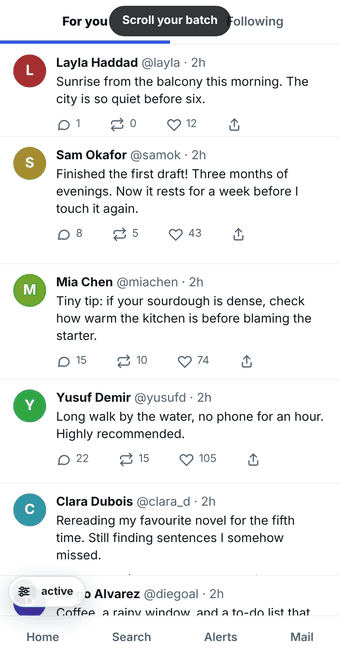
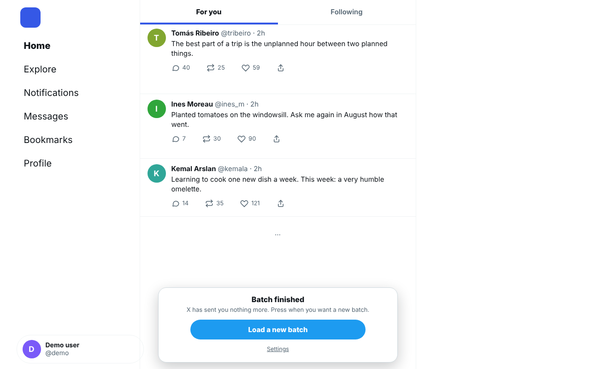

# OnDemand for X (Twitter)

**Your timeline, one batch at a time — only when you press the button.**

X's Home feed keeps fetching more posts as you scroll, so there is never an end. OnDemand gives it one. You get the batch X sends first; the *next* batch is requested from X **only when you press "Load a new batch"**. Until then X is not even asked, so nothing is sent to you that you did not ask for.

<p align="center">
  
</p>

<p align="center">
  
</p>

*(The animation and screenshots show a simulated demo feed, not real accounts.)*

[العربية ←](README.ar.md)

## What it does — and does not do

| | |
|---|---|
| ✅ | Holds back **one request**: the one X sends by itself when you reach the end of the Home timeline (**For you** and **Following**). |
| ✅ | Lets you read, like, reply and scroll back through everything that already arrived, as long as you like. |
| ✅ | Designed so that X simply waits for the answer and the answer comes when you press the button: no reload, no error page. Confirmed against a simulated X; how real X behaves after a very long wait is one of the things the beta is meant to confirm. |
| ✅ | No data collected, no network requests of its own, no account, no analytics. [Privacy policy](PRIVACY.md) |
| ❌ | It does **not** hide posts, filter them, or change what X sends you. |
| ❌ | It does **not** decide how many posts a batch has (that is X's choice, and it varies). |
| ❌ | It does not touch search, profiles, replies, lists, notifications or anything else, only the Home feed's *next page*. |

The small spinner X shows under the last post is normal: X is waiting for the answer that you have not asked for yet.

### Why "hold" instead of "hide" or "block"?

| Approach | What really happens |
|---|---|
| Hide posts | X still downloads every page in the background; you just do not see it. The feed keeps "delivering" posts to you. |
| Block the request | X receives an error, shows *Something went wrong*, often reloads, or retries in a loop. |
| **Hold the request (this extension)** | The request waits inside your browser. X is not contacted and, in our tests, shows no error and does not reload. You press a button when you want more. |

## Install

> **Store links are added here when the listings are approved.** Until then use a release package.

1. Download the package for your browser from the [latest release](../../releases/latest):
   - `ondemand-for-x-<version>-chromium.zip` — Chrome, Edge, Brave and other Chromium browsers, **Lemur Browser (Android)**
   - `ondemand-for-x-<version>-firefox.zip` — Firefox 128+ (desktop and Android)
2. **Chrome / Edge / Brave (desktop):** unzip it into a folder you keep, open `chrome://extensions` (Edge: `edge://extensions`), switch on **Developer mode**, press **Load unpacked** and choose the folder.
3. **Lemur Browser (Android):** open the menu → **Extensions** and look for the option to add an extension from a local file, then pick the downloaded package. The wording differs between Lemur versions and we have not checked them all (tell us in an issue if yours is different). Make sure the extension is switched on afterwards.
4. **Firefox:** unsigned packages can only be loaded temporarily (`about:debugging` → *This Firefox* → *Load Temporary Add-on*); for a permanent install use the Firefox Add-ons listing when it is published.
5. Open `x.com/home` and refresh. A small chip with a slider icon appears at the bottom-left of the feed and says **active**.

Every release lists the SHA-256 of its files in `SHA256SUMS.txt`.

## Use

1. Scroll the batch X gave you. Read, like, reply.
2. At the end of the batch a panel appears: **Batch finished — Load a new batch**. X has sent nothing more.
3. Press the button when you want more. One batch arrives, then it stops again.

The chip shows the state: *active* · *waiting for you* (a batch is waiting for your button) · *loading…* · *off* · *load failed* (press X's own **Retry**; it goes straight through) · *not working* / *no X requests seen* (the extension cannot see X's requests; X keeps working as if the extension were not installed).

The slider icon opens the settings: on/off, language, and a **Diagnostics** box with a text you can copy when you report a problem.

**Languages (14):** العربية · English · Deutsch · Español · Français · Bahasa Indonesia · 日本語 · 한국어 · Português (Brasil) · Русский · ไทย · Türkçe · 简体中文 · 繁體中文. *Auto* uses the language X is shown in, then your browser's. English is the reference text and Arabic is the author's own language; **every other language was drafted with AI assistance and is waiting for review by native speakers** — corrections are very welcome ([how](CONTRIBUTING.md#translations)).

## Status — what has been tested

| Where | Status |
|---|---|
| Chromium (desktop) against a simulated X page: parking, release, refresh, tab switching, failed requests, other extensions wrapping the same APIs, RTL, 320–1280 px layouts, every language, the packaged build under a strict page policy | ✅ automated tests ([`test/`](test/)) run on every change |
| Lemur Browser (Android), real X | ✅ the version this one grew out of was confirmed on a real phone; **0.9.1 is waiting for the same confirmation** |
| Chrome / Edge / Brave desktop, real X | ⏳ not confirmed yet |
| Firefox desktop / Android | ⏳ the package follows Mozilla's rules and shares all the logic, but **has not been run in Firefox yet** |
| Safari | ❌ not supported |

X changes its website without notice. The extension is built to **step aside rather than break the page**: if it cannot recognise what X is doing, requests pass through untouched and the chip says so. If something stops working, copy the Diagnostics text and [open an issue](../../issues/new/choose).

## FAQ

**Does it work with other extensions?** Extensions that also wrap X's network calls are tolerated (there is a test for it), but we cannot test every combination. If something conflicts, please report it.

**Can X tell that I use it?** The extension makes no network requests of its own, and X sees the same kind of "next page" request it always sees, only later, when you press the button. It automates nothing. But a website can, in principle, notice that its network functions have been wrapped by a script (as with many extensions), and this extension does not try to hide. We cannot speak for X's rules; you use it at your own judgement.

**Why does a post show a loading spinner below it?** See above: X is waiting for the answer that you have not requested yet.

**It says "not working" / "no X requests seen".** X may have changed something, or another extension is in the way. Nothing is broken for you: X loads as usual. Please send the Diagnostics text.

**Can I change the batch size?** No. X decides it. This extension decides *when*, not *how much*.

## How it works

A short script runs inside X's page and wraps the browser's `XMLHttpRequest` and `fetch` for one thing only: the Home timeline's request for the next page. That request is parked, not sent. The extension's interface shows the button; pressing it lets the parked request go. If the interface stops answering (the extension was updated or switched off while a page was parked, say), the parked page is let through after about 15 seconds. Details, design rules and the fail-open list: [docs/HOW-IT-WORKS.md](docs/HOW-IT-WORKS.md).

## Develop

```bash
npm install                      # Playwright (tests only)
npx playwright install chromium
npm run check                    # locale and store-text checks + build + the whole test suite
node tools/build.js              # packages in dist/
```

Node 18+ is enough to build (no npm packages needed; see [BUILD.md](BUILD.md)); the tests need Playwright's Chromium. See [CONTRIBUTING.md](CONTRIBUTING.md), [docs/BETA-TESTING.md](docs/BETA-TESTING.md) (help us test on real devices) and [docs/RELEASING.md](docs/RELEASING.md).

## Support

OnDemand for X is free and open source. If you find it useful and want to support its development, you can do so on Ko-fi: <https://ko-fi.com/renless>. It is entirely optional, and the extension itself contains no donation links or prompts.

## Licence

[MIT](LICENSE). *OnDemand for X is an independent project. It is not affiliated with, endorsed by or sponsored by X Corp. "X" and "Twitter" are trademarks of their owners and are used only to say which website the extension works with.*
